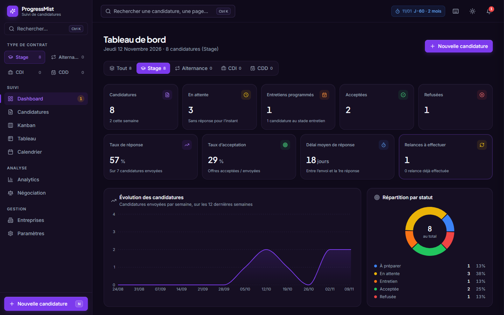
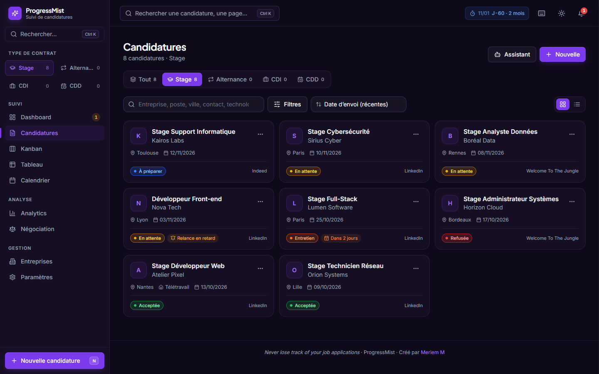
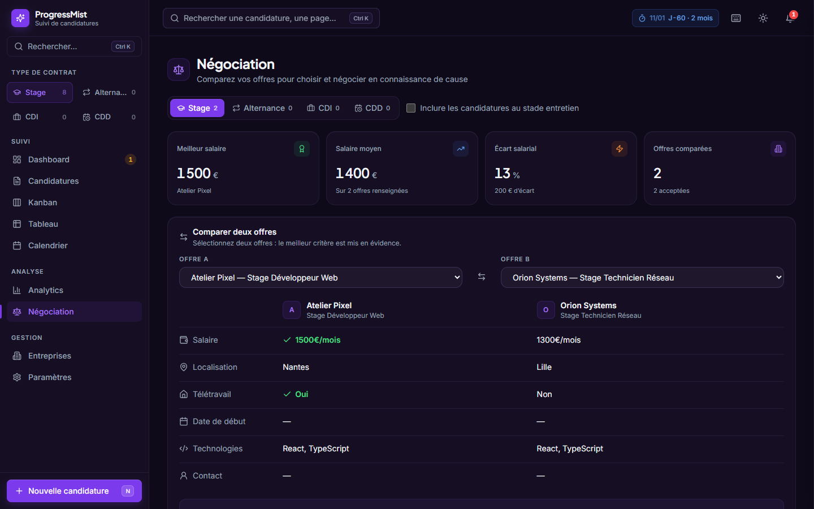

# 🚀 ProgressMist

> Une application moderne de suivi de candidatures conçue pour aider les étudiants et les chercheurs d'emploi à organiser efficacement leurs recherches.
>
> 🌐 **Lien :** https://elgatoo00.github.io/ProgressMist/#/dashboard

## 📸 Aperçu

_Captures réalisées avec des données de démonstration fictives._

> Dashboard



> Candidature



> Négociation entre 2 offres




---

## ✨ Fonctionnalités

- 📋 Gestion complète des candidatures
- 📊 Tableau de bord avec statistiques
- 📅 Suivi des dates importantes
- 🏢 Gestion des entreprises
- 📌 Statut des candidatures
  - À envoyer
  - Envoyée
  - Entretien
  - Refusée
  - Acceptée
- 🔍 Recherche et filtres
- 📱 Interface responsive
- 💾 Sauvegarde locale (LocalStorage)
- ⚡ Application rapide (SPA)

---

## 🛠️ Technologies

- React
- TypeScript
- Vite
- React Router
- Zustand
- Tailwind CSS
- LocalStorage

---

## 🚀 Installation

```bash
git clone https://github.com/elgatoo00/ProgressMist.git

cd ProgressMist

npm install

npm run dev
```

---

## 📦 Build

```bash
npm run build
```

---

## 🌍 Déploiement

Le projet est déployé avec **GitHub Pages**. GitHub Pages permet d'héberger gratuitement des sites statiques directement depuis un dépôt GitHub.


---

## 🔒 Sécurité et confidentialité

- Aucune donnée n'est envoyée à un serveur : tout reste dans le **LocalStorage de votre navigateur**.
- Aucune clé API, aucun compte, aucun suivi.
- Les liens enregistrés ou importés sont filtrés (seuls `http(s)`, `mailto` et `tel` sont acceptés) et une *Content-Security-Policy* stricte est appliquée au site publié.
- Pensez à **exporter vos données** (Paramètres → Exporter) : vider le cache du navigateur les efface.

---

## 🎯 Objectif

ProgressMist a été créé afin de simplifier le suivi des candidatures en centralisant toutes les informations importantes dans une seule application :

- entreprises contactées
- postes visés
- dates de candidature
- relances
- entretiens
- résultats

L'objectif est d'éviter les oublis et d'avoir une vision claire de l'avancement de sa recherche d'emploi ou de stage.

---

## 🔮 Améliorations prévues

- Authentification
- Synchronisation Cloud
- Notifications
- Calendrier intégré
- Export PDF
- Import / Export des données
- Tableau Kanban
- Mode sombre
- Statistiques avancées

---

## 👨‍💻 Auteur

**Meriem M.**

Étudiante en BTS SIO – Option SISR

GitHub : https://github.com/elgatoo00

---

## 📄 Licence

Projet réalisé à des fins pédagogiques.
